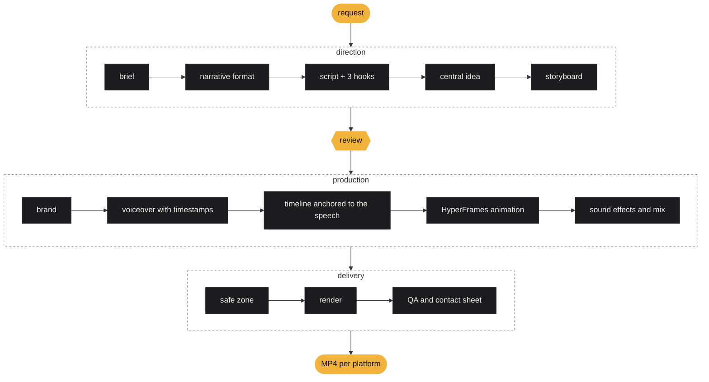

<p align="center">
  
</p>

<p align="center">
  <b>You send the idea. A coding agent writes the script, records the voiceover, animates each scene to the timing of the speech and delivers the MP4 ready to post.</b>
</p>

<p align="center">
  
  
  
  
  <a href="https://github.com/eusilvio/motion-cena/actions/workflows/ci.yml"></a>
</p>

<p align="center">
  by <b>Silvio Campos</b> · <a href="https://github.com/eusilvio">github.com/eusilvio</a>
</p>

<p align="center">
  <a href="README.md">Português</a> · <b>English</b>
</p>

---

<table>
<tr>
<td width="44%" valign="top">


</td>
<td width="56%" valign="top">

### On set

Asking for "a nice-looking video" gets you random animation that has nothing to do with the narration. motion-cena works like a small production company: first it decides **which story**, **in which format** and **what each scene shows**. Only then does it animate.

- **The speech sets the timing.** The voiceover is made before the animation. Each word gets a timestamp, and each emphasis fires on the exact frame where the word is spoken.
- **One visual idea per video.** Each piece grows out of its own device (an ID card, a panel, a page), chosen from three concepts, and the system vetoes anything that repeats earlier videos.
- **Every step writes a file.** You can stop, review and ask for only the part that changed: "swap the hook", "make the Stories version".
- **Nothing ends up under the buttons.** A checker scans the video every quarter of a second and fails any text, card or logo that enters the Reels, TikTok or Shorts interface area.

Next to this: five of the **44 curated effects** in the effects dictionary, rendered by the pipeline itself. The full catalog has **388**.

</td>
</tr>
</table>

---

## Scene 01 · Build the set

```bash
git clone https://github.com/eusilvio/motion-cena.git
cd motion-cena
./setup.sh      # checks Node, FFmpeg, uv and the agent; creates the local folders and .env.local
claude          # or codex, agy, opencode, or open the folder in Cursor, Windsurf or VS Code with Copilot
```

You need **Node 22+**, **FFmpeg**, **[uv](https://docs.astral.sh/uv/)** and a coding agent. With no API key at all, the whole pipeline runs: free voice through edge-tts and sound effects synthesized on your machine. With `ELEVENLABS_API_KEY` in `.env.local`, the voice gets better (and you can clone your own).

### On Windows

Use **WSL 2**: the whole pipeline runs, same as on Linux. `setup.ps1` prepares the folder from PowerShell, but on native Windows part of the flow does not run (limits at the end of the walkthrough).

<details>
<summary><b>Step by step</b> · WSL 2 or PowerShell</summary>

#### WSL 2 (recommended)

1. Open PowerShell as administrator, install Ubuntu and restart the computer:

   ```powershell
   wsl --install -d Ubuntu-24.04
   ```

   After restarting, open **Ubuntu** from the Start menu and create your username and password. All the commands below run in that terminal.

2. Install FFmpeg, Git, Node (through nvm) and uv:

   ```bash
   sudo apt update && sudo apt install -y git ffmpeg
   curl -o- https://raw.githubusercontent.com/nvm-sh/nvm/v0.40.8/install.sh | bash
   curl -LsSf https://astral.sh/uv/install.sh | sh
   exec bash                 # reloads the terminal with nvm and uv on the PATH
   nvm install --lts
   ```

3. Install the Chromium libraries (the render and the safe-zone checker use a headless Chrome):

   ```bash
   uvx playwright install --with-deps chromium
   ```

4. Clone **inside your Linux file system**, not in `/mnt/c`. In `/mnt/c` every file access crosses over to Windows: `npx` and rendering get much slower, and the live preview does not notice files edited by Windows programs.

   ```bash
   cd ~
   git clone https://github.com/eusilvio/motion-cena.git
   cd motion-cena
   ./setup.sh
   npx hyperframes doctor    # checks Chrome and FFmpeg
   ```

5. Install and open your agent in the same terminal, at the project root (`claude`, `codex`, `opencode` or another). For VS Code or Cursor, run `code .` or `cursor .` from here: the editor opens connected to WSL.

To see the finished videos in Windows, run `explorer.exe creatives` or open `\\wsl.localhost\Ubuntu-24.04\home\<your-username>\motion-cena` in Explorer. If you cloned from Windows earlier and `./setup.sh` fails with `bash\r`, clone again inside WSL.

#### Native PowerShell

```powershell
winget install Git.Git
winget install OpenJS.NodeJS.LTS
winget install Gyan.FFmpeg
winget install astral-sh.uv
# close and reopen the terminal so the new PATH takes effect
git clone https://github.com/eusilvio/motion-cena.git
cd motion-cena
powershell -ExecutionPolicy Bypass -File .\setup.ps1
```

`setup.ps1` does the same as `setup.sh` and tells you what is missing. In `.claude\skills` it creates junctions, which do not need administrator rights. If you move the project folder, run `setup.ps1` again.

Limits on native Windows:

- `qa_video.sh` and `analyze_reference.sh` are bash scripts. Claude Code runs both through Git Bash when Git for Windows is installed. Agents that run commands in PowerShell (Codex, Gemini CLI, Copilot CLI) cannot run them.
- The `tools/studio` interface does not run on native Windows.
- If PowerShell says running scripts is disabled when you run `npx`, allow it for your user: `Set-ExecutionPolicy -Scope CurrentUser RemoteSigned`.
</details>

## Scene 02 · Make the request

Talk to the agent the way you would talk to a video editor:

| You ask | You get |
|---|---|
| *"Make a 30 s Reels explaining compound interest. Research the facts."* | sourced research, a script with 3 hooks, voiceover, animation and the MP4 for Reels and TikTok |
| *"Turn this PDF into a data video in my website's style."* | the best numbers from the report, with the source page, in the website's colors and fonts |
| *"Analyze the app in ../loja and make a 40 s product video."* | facts, screens and brand taken from the code itself (without reading `.env` or production data) |
| *"Animate over this video of me talking, with word-by-word captions."* | your recording as the base, with captions, keywords and cards in the rhythm of the speech |
| *"Make it a 7-slide carousel."* | a cover with a hook, one slide per idea, a PNG per slide, post caption and alt text |
| *"Title enters with a slide in, 0.4 s ease out, benefits with a 0.15 s stagger."* | exactly that: the dictionary turns each term into code |

Write in any language: the pipeline understands the request and delivers in the language you wrote in.

Then you iterate: *"switch to hook B"*, *"drop the music"*, *"split it into 3 stories"*, *"make the YouTube version"*.

## Scene 03 · How long it takes and what it costs

Numbers from real productions made with this repository in Claude Code (Opus 5.5), between Oct 20 and Nov 4, 2026, on an ordinary laptop. Treat them as an order of magnitude: yours will vary.

| Piece | Voice | To 1st delivery | With revisions | Total tokens | Equivalent API cost | Render |
|---|---|---|---|---|---|---|
| 30 s Reels from a product's code | ElevenLabs | 30 min | 42 min (1 revision) | 24.8 M | US$ 10.58 (US$ 8.37 at 1st delivery) | 2 min 18 s |
| 46 s Reels from a product's code, with a music track | ElevenLabs (voice and music) | 25 min | 41 min (1 revision) | 25.2 M | US$ 12.18 (US$ 8.03 at 1st delivery) | 2 min 20 s to 2 min 32 s |
| 6-slide carousel from finished text, with the numbers checked on the web | no voice | 3 min | 7 min (2 revisions) | 8.5 M | US$ 3.22 (US$ 1.24 at 1st delivery) | 5 s (PNG) |

The minutes count the time the agent was working, from your request to its last action. The time you take to look and reply is not included. Each revision round on the videos added 12 to 16 min and 8 to 10 M tokens (US$ 2 to 4). In every case, 98% of the tokens were cache reads, the cheapest part.

**To spend less:** make one piece per session. Every request re-reads the whole conversation, and in the measured sessions a second piece in the same conversation cost 35% to 41% of that session. When a video is done, open a new session (`/clear` in Claude Code): everything is saved in `projects/<slug>/` and the agent picks up where it left off. Connectors and plugins you don't use for video also weigh on every request; turn them off for this project.

<details>
<summary><b>Per-step timings, voice and Claude plans</b></summary>

Measured on a 4-core Intel i5-8265U, 11.6 GB of RAM, no dedicated GPU, Linux:

| Step | Time |
|---|---|
| Render of 30.5 s at 1080×1920, 30 fps (`npx hyperframes render`, default quality) | 1 min 50 s, about 5 cores busy and 1.5 GB of extra RAM |
| The same render with `--quality draft` (for iterating) | 1 min 22 s |
| edge-tts voiceover, 77 words in pt-BR (23 s of audio) | 3 s (9 s the first time, while `uv` installs the dependency) |
| Safe zone (`safe_zone_check.py`) + QA (`qa_video.sh`) | 21 s + 7 s |
| Exporting a 6 to 8 slide carousel as PNG | 5 to 10 s |

**Voice.** edge-tts is free. On ElevenLabs, a 30 s voiceover has 415 to 495 characters (82 to 96 words). At US$ 0.08 per 1,000 characters on the multilingual v2, v3 and v4 models, each generation costs about US$ 0.04, and the Starter plan (US$ 6/month, 75,000 characters on those models) covers about 150 voiceovers of 30 s. Music from Eleven Music costs US$ 0.15 per minute ([ElevenLabs API pricing](https://elevenlabs.io/pricing/api), checked on Nov 4, 2026).

**Is the Pro plan enough?** Pro (US$ 20/month) and Max (US$ 100/month, with five times Pro's usage) include Claude Code. Both have a 5-hour session limit and a weekly limit, shared between Claude and Claude Code, and Anthropic does not publish how many tokens fit in each window ([Claude Code on Pro and Max](https://support.claude.com/en/articles/11145838-use-claude-code-with-your-pro-or-max-plan), [how usage limits work](https://support.claude.com/en/articles/11647753-how-do-usage-and-length-limits-work), [Max plan](https://support.claude.com/en/articles/11049741-what-is-the-max-plan), checked on Nov 4, 2026). Nobody has tested it on Pro yet, so there is no way to promise how many videos fit in it. Keep an eye on the bars with `/usage` in Claude Code. If you hit the limit in the middle of a video, turn on usage credits or continue after the reset: every step is saved in `projects/<slug>/` and the agent picks up where it left off.

Caveats on these numbers:

- Claude Code only, with Opus 5.5 (`xhigh` effort on both videos, `medium` on the carousel). Codex, Antigravity, Cursor and the others count usage differently and were not measured.
- "Equivalent API cost" is tokens × the Opus 5.5 list price (per million: US$ 4 input, US$ 8 1-hour cache write, US$ 0.20 cache read, US$ 20 output). If you are on a plan, you do not pay this per video; the number is there for comparison.
- More revision rounds, a long session (every request rereads the history, so one video per session is cheaper), a large repository to read, web research and higher effort all increase tokens and minutes.
- Rendering ran on the CPU only, with other sessions open on the same machine, so the times are a little pessimistic. Compositions with full-screen photos, blur and grain take much longer (a 62 s one took 6 min 20 s).
</details>

Measurements on other machines and agents are welcome: open an issue with your numbers.

## Scene 04 · From request to MP4



Each box writes a file in `projects/<slug>/` (`brief.md`, `plan.md`, `storyboard.json`, `brand.json`, `audio/words.json`, `timeline.json`, `video/`, `audio/mix.wav`), and the final video comes out in `creatives/reels/<slug>-<plataforma>.mp4`.

## Scene 05 · Watch the edit live (if you want)

Watching live is optional. Ask *"I want to watch it live"* and, during the animation step, the agent opens **HyperFrames Studio** as soon as the first scene exists. If you don't ask, it works quietly and delivers the MP4. Studio reloads on every saved file: you watch the video come together scene by scene, with a timeline, playback and manual editing. Clicked an element and said "change this"? The agent reads the Studio selection and knows exactly what you pointed at.

Want chat and video on the same screen? Start the project's interface:

```bash
node tools/studio/server.mjs        # opens http://127.0.0.1:4400
```

| Left | Right | Top |
|---|---|---|
| chat with Claude Code, Codex or Antigravity, with each command and file showing up as it happens | the Studio of the project being edited, plus tabs for the script, storyboard and final video | the pipeline steps lighting up as the files appear |

> The interface listens only on `127.0.0.1`, requires a token per run and runs the agent **with automatic approval** (a web page has no way to answer its permission prompts). Use it on your own machine, in repositories you trust.

## Scene 06 · Any agent

The pipeline is text and the command line. Any agent that reads files and runs terminal commands can direct it.

| File | For |
|---|---|
| `AGENTS.md` | Codex, Antigravity, Cursor, GitHub Copilot, OpenCode, Windsurf, Amp, Zed and most agents |
| `CLAUDE.md` · `GEMINI.md` | they only import `AGENTS.md` for Claude Code and Gemini CLI |
| `.agents/skills/` | the `motion-cena` skill and the official HyperFrames skills, in the folder agents share by convention |
| `.claude/skills/` | links only to the 6 skills the pipeline uses (list in `.agents/skills/claude-links.txt`), created by `setup.sh` or by Claude itself in the first session. Every linked skill sends its description on every request |

A tool that exists in only one agent (Claude Design, an MCP connector) is optional: the skill always describes the path that works in any of them.

## Scene 07 · Every video with its own look

The repository ships blank: no brand, voice or persona from anyone. The identity comes from the request.

| You send | Brand | Voice and tone |
|---|---|---|
| website, colors, fonts or logo | extracted from what you sent | whatever the request says |
| the product's code | the repository's theme, tokens, fonts and logo | the app's real copy |
| a recording of someone speaking | only if the request includes it | the voice is the one in the recording, with no re-recording |
| *"same brand as project X"* | copied from project X | taken from X's brief |
| nothing | its own visual direction, born from the video's idea | the natural tone of the genre |

## Something went wrong?

Run the two diagnostics first. `setup.sh` points out what is missing (Node, FFmpeg, uv), and the HyperFrames `doctor` checks Node, FFmpeg, Chrome, memory and disk:

```bash
./setup.sh
npx hyperframes doctor
```

In `doctor`, a failure on `TTS (Kokoro)` or `BGM (MusicGen)` can be ignored (they are why it ends with "Some checks failed" even when everything is fine): they are optional local alternatives, and motion-cena does not depend on them.

<details>
<summary><b>The render is slow, stops halfway or disappears</b></summary>

**Symptom.** One of these messages, or a video that never shows up:

```
Command did not complete within its 600s timeout and was moved to the background
Render cancelled: render_cancelled_parent_exited
Background command "..." was stopped because the system is running low on memory
```

Sometimes a `creatives/reels/work-*/` folder is left behind with a `video-only.mp4` that `ffprobe` rejects with `moov atom not found`.

**Cause.** A 30 s video takes 1.5 to 2.5 min to render on an ordinary laptop, and heavy compositions (full-screen photos, blur, grain) go past 6 min. When the agent's command ends or times out, HyperFrames cancels the render along with it. With other renders or Studio previews open, memory runs out.

**Fix.** Close what is open and run the render detached from the agent, with fewer workers:

```bash
npx hyperframes preview --list                 # Studio previews still running
npx hyperframes preview --stop                 # inside the project folder that no longer needs it
cd projects/<slug>/video
bash -c 'set -m; HYPERFRAMES_RENDER_DETACHED=1 npx hyperframes render -o ../../../creatives/reels/<slug>-ig-reels.mp4 --workers 2 < /dev/null > ../out/render.log 2>&1 &'
tail -f ../out/render.log                      # ends with "rendered in ..."
```

While iterating, use `--quality draft` (here, 1 min 22 s instead of 1 min 50 s for 30 s of video). Delete the `creatives/reels/work-*` folder the interrupted render left behind.
</details>

<details>
<summary><b>Render Chrome not found (HyperFrames)</b></summary>

**Symptom.**

```
[BrowserManager] Chrome binary not found at ... Run `hyperframes browser ensure` to re-download.
```

or a warning that the Chrome file is corrupted.

**Cause.** HyperFrames renders with its own Chrome (about 260 MB in `~/.cache/hyperframes/chrome`). The download on the first render failed or was interrupted, or the cache was deleted.

**Fix.**

```bash
npx hyperframes browser ensure          # downloads the Chrome version pinned by HyperFrames
npx hyperframes browser ensure --force  # deletes a broken download and downloads it again
npx hyperframes browser path            # shows which executable is in use
```
</details>

<details>
<summary><b>Safe-zone checker Chrome (Playwright)</b></summary>

**Symptom.** `safe_zone_check.py` stops with:

```
BrowserType.launch: Executable doesn't exist at .../ms-playwright/chromium_headless_shell-.../chrome-headless-shell
Looks like Playwright was just installed or updated.
Please run the following command to download new browsers:
    playwright install
```

**Cause.** The checker uses Playwright, which has its own Chromium, separate from the HyperFrames one. The script tries that Chromium and then a Google Chrome installed on the system. With neither, it stops.

**Fix.**

```bash
uv run --with playwright playwright install chromium
```

On a Linux machine without the browser libraries, add `--with-deps` (asks for sudo). To see what it will download first: `--dry-run`.
</details>

<details>
<summary><b>edge-tts produces no audio</b></summary>

**Symptom.**

```
edge_tts.exceptions.NoAudioReceived: No audio was received. Please verify that your parameters are correct.
```

**Cause.** A wrong voice name, no internet, or an outdated edge-tts version after a change in Microsoft's service (the service is free and unofficial).

**Fix.** Check the voice name and force the newest version:

```bash
uv run --with edge-tts edge-tts --list-voices | grep pt-BR
# pt-BR-AntonioNeural, pt-BR-FranciscaNeural, pt-BR-ThalitaMultilingualNeural
uv run --refresh-package edge-tts .agents/skills/motion-cena/scripts/tts_edge.py --text-file projects/<slug>/narration.txt --voice pt-BR-FranciscaNeural --out projects/<slug>/audio
```

If it keeps failing, ask for the voiceover through ElevenLabs.
</details>

<details>
<summary><b>ElevenLabs rejects the request</b></summary>

**Symptom.** One of these:

```
ELEVENLABS_API_KEY not set (run: npx -y @elevenlabs/cli@latest onboard init)
status_code: 401 ... 'Neither authorization header nor xi-api-key received, please provide one.'
status_code: 400 ... 'code': 'voice_not_found'
status_code: 429 ... 'code': 'concurrent_limit_exceeded', 'message': 'Too many concurrent requests. ...'
```

**Cause.** The key is not in `.env.local` (or the script ran outside the repository); the requested `voice_id` no longer exists in your account (a cloned voice that was deleted, for example); or the agent fired more generations in parallel than your plan allows.

**Fix.** Put `ELEVENLABS_API_KEY=...` in the `.env.local` at the repository root and list the voices your account can see:

```bash
uv run .agents/skills/motion-cena/scripts/tts_elevenlabs.py --list-voices
```

On a 429, ask the agent to generate one voiceover at a time.
</details>

<details>
<summary><b>Node, FFmpeg or uv missing or on the wrong version</b></summary>

**Symptom.**

```
HyperFrames requires Node.js >= 22 (current: v20...). Switch Node versions and retry.
[FFmpeg] ffmpeg not found
Unknown encoder 'libx264'
uv: command not found
```

**Cause.** An old Node, FFmpeg missing or built without H.264, or `uv` not installed. The QA and mixing scripts call the `ffmpeg` on the PATH, so the first `ffmpeg` on the PATH needs `libx264` and `aac`.

**Fix.**

```bash
node -v                                             # must be 22 or higher; with nvm: nvm install 22
which -a ffmpeg                                     # which ffmpeg comes first on the PATH
ffmpeg -hide_banner -encoders | grep -E ' libx264 | aac '
curl -LsSf https://astral.sh/uv/install.sh | sh     # installs uv
```

If HyperFrames needs a different FFmpeg, point to it with `HYPERFRAMES_FFMPEG_PATH` and `HYPERFRAMES_FFPROBE_PATH`, then check with `npx hyperframes doctor`.
</details>

<details>
<summary><b>QA failed the video</b></summary>

**Symptom.** `qa_video.sh` ends in `RESULT: FAIL` with one of these lines:

```
FAIL no silent gaps > 1.5s (found 1)
FAIL audio track none
FAIL loudness -16.55 LUFS (want -16..-12)
```

**Cause.** The first is the most common: the end card goes silent after the last word. The second shows up when the render came out without `mix.wav`. The third, when the mix came out too quiet.

**Fix.** Shorten the end card or keep music and a sound effect under it. For the audio, redo the mix and render again:

```bash
uv run .agents/skills/motion-cena/scripts/mix_audio.py projects/<slug>/timeline.json --voice projects/<slug>/audio/voice.mp3 --sfx-dir projects/<slug>/audio/sfx --lufs -14 --out projects/<slug>/audio/mix.wav
```
</details>

Also seen, less often:

- `Prompt is too long` in a 16-hour session: run `/compact` or open a new session per video. Every step is saved in `projects/<slug>/`, so the agent picks up where it left off.
- `[Compiler] WARNING: Failed to download CDN script: https://cdn.jsdelivr.net/npm/gsap@.../gsap.min.js (TypeError: fetch failed)` with no internet: save `gsap.min.js` in `video/assets/vendor/` and point the `<script>` to it.
- `Continuing render despite lint issues` is a warning, not an error. To see the issues: `npx hyperframes check`.

---

## Behind the scenes

<details>
<summary><b>What you can send</b> · nine input modes</summary>

| Mode | You send | What happens |
|---|---|---|
| **Script** (default for your own text) | a text or script | becomes a video script: keeps the facts, the intent and the sentences in your voice; adjusts the duration, the hook, how it sounds out loud and the ending |
| **Verbatim narration** | text + "use it exactly as it is" | word for word; pronunciation tweaks only in a separate file for the TTS |
| **Notes** | topics, bullets, a transcript | organizes them into a story, picks a format, writes the script |
| **Topic** | just the subject | web research with sources, then the script |
| **Long source** | PDF, report, article, URL | reads all of it and pulls the best excerpts, with the source page |
| **Data** | spreadsheet, CSV, numbers | finds the story in the numbers; each number gets a visual |
| **Recorded audio** | a voiceover | transcribes it with timestamps and animates over that voice |
| **Recorded video** | someone speaking (talking head, talk, interview) | the footage and the voice are the base; the motion goes on top |
| **Code** | a product's path or repository | facts, screens and brand come from the code |

Text longer than the platform allows? The system warns you and offers to split it into parts, condense it or switch platforms. It never cuts silently.
</details>

<details>
<summary><b>Genres</b> · structure and visual language for each type of video</summary>

| Genre | Structure | Visuals and motion |
|---|---|---|
| **Story** | conflict → character → obstacle → turn → ending | recurring visual metaphor, match cut, slow push-in |
| **Motivational** | shock line → recognizable pain → reframe → call to action | large kinetic typography (slam, line reveal), one idea per screen, punch zoom on the peaks |
| **Technical** | result → numbered steps → pitfall → recap | UI and code with typewriter and highlight, draw-on arrows |
| **Explainer** | question → analogy → mechanism → example → summary | a diagram that builds itself (draw-on, stagger, morph) |
| **Data / news** | hook number → context → contrast → implication | count-up, bar grow, side-by-side comparison |
| **Product** | pain → solution → 3 benefits → proof → CTA | pop in, benefit stagger, punch zoom on the product, wipe in the brand color |
| **Opinion** | thesis → arguments → objection → conclusion | large key text, split screen, myth × truth |

Narrative formats: comparison, transformation, experiment, tutorial, listicle, ranking, myth × truth, prediction, behind the scenes, character story, open question, manifesto, explanation by analogy.
</details>

<details>
<summary><b>Platforms</b> · presets, durations and safe zones</summary>

Each platform is a preset in `assets/platforms.json`, taken from the official documentation (Oct 2026).

| Preset | Platform | Canvas | Max | Ideal | Safe zone (top / bottom / sides) |
|---|---|---|---|---|---|
| `ig-stories` | Instagram Stories | 1080×1920 | 60 s per story | 5–15 s | 269 / 672 / 65 |
| `ig-reels` | Instagram Reels | 1080×1920 | 3 min | 15–60 s | 269 / 672 / 65 |
| `ig-feed` | Instagram Feed | 1080×1350 | 3 min | 15–60 s | 60 |
| `fb-reels` | Facebook Reels | 1080×1920 | 3 min | 15–60 s | 269 / 672 / 65 |
| `vertical` | Reels + TikTok + Shorts | 1080×1920 | 3 min | 15–60 s | 288 / 672 / 65 left · 192 right |
| `tiktok` | TikTok | 1080×1920 | 10 min | 15–60 s | 160 / 480 / 60 left · 140 right |
| `yt-shorts` | YouTube Shorts | 1080×1920 | 3 min | 20–60 s | 288 / 672 / 48 left · 192 right |
| `yt-long` | Horizontal YouTube | 1920×1080 | no limit | 1–15 min | 54 / 140 / 96 |
| `yt-long-4k` | YouTube 4K | 3840×2160 | no limit | 1–15 min | 108 / 280 / 192 |
| `linkedin` | LinkedIn | 1080×1350 | 15 min | 30–90 s | 60 |
| `square` | Generic feed / X | 1080×1080 | no limit | 15–60 s | 60 |

Shared output: MP4 H.264 `yuv420p`, constant frame rate, AAC 48 kHz, `+faststart`, −14 LUFS. One narration and one timeline produce every version; only the layout is recomposed.
</details>

<details>
<summary><b>Carousel</b> · the same idea as slides, without narration</summary>

Turn it on with "make it a carousel" (or "make the video and the carousel"). The flow becomes brief → slide plan → design → export.

| Engine | Output |
|---|---|
| **Local** (any agent) | `creatives/carrossel/<slug>-ig-carousel/01.png … NN.png`, `contact.jpg` and `carousel.pdf` for LinkedIn |
| **Claude Design** (Claude agent with Artifact) | an editable canvas on claude.ai, one artboard per slide |

Presets `ig-carousel` (1080×1350), `ig-carousel-square` (1080×1080) and `linkedin-carousel` (PDF). `legenda.txt` (the post caption) and `alt-text.txt` come with it.
</details>

<details>
<summary><b>Effects dictionary</b> · 44 curated plus a catalog of 388</summary>

`references/motion-dictionary.md` is the shared vocabulary between you, the storyboard and the code. Each effect has a definition, a default duration and ease, and render-safe GSAP code. The formula for asking: **effect + duration + ease + target**.

| Family | Effects |
|---|---|
| Entrances | fade in, slide in, blur in, pop in, scale up, stagger |
| Timing | ease in-out, overshoot, bounce |
| Text | typewriter, word reveal, text swap, scramble, line reveal, highlight, slam, count-up |
| Shapes | draw-on, morph, bar grow |
| Emphasis | pulse, shake, glow, wiggle |
| Physics | anticipation, squash & stretch, follow-through, float |
| Camera | push-in, parallax, whip pan, dolly zoom |
| Transitions | mask reveal, wipe, punch zoom, zoom through, iris, push, glitch, flash, blinds, match cut |
| Finishing | motion trail, grain |

All rendered in `creatives/demos/` (source in `training/dicionario-demo*/`).

**Expanded catalog.** `references/motion-dictionary/` holds **388 effects in 16 families**, the 44 included: soft and impact entrances, exits, text, emphasis, physics, ambient loops, camera, transitions, SVG shapes, data and infographics, interface, stylization and texture, particles, 3D and masks. Each one has a Portuguese name, aliases, when to use it, what to avoid, defaults for vertical at 30 fps and GSAP code. The agent never reads the whole catalog: it searches for the term you asked for.

```bash
uv run .agents/skills/motion-cena/scripts/motion_lookup.py "texto hacker"     # by name, alias or Portuguese name
uv run .agents/skills/motion-cena/scripts/motion_lookup.py --family particulas
```

The 344 that are not in the demos yet run in a browser in the tests, but nobody has seen them in a rendered video: when it uses one, the agent checks the snapshot of that scene. Moving an effect from the catalog into the curated dictionary, with a demo scene, is a good first contribution (the catalog's texts are in Portuguese).
</details>

<details>
<summary><b>Real symbols and clean copy</b> · real flags, real logos, nothing that reads like AI</summary>

Before the storyboard, the system reads each sentence and picks a visual that says the same thing without the audio, in this order: real symbol → concrete object → openly licensed photo → data → metaphor → typography.

| Mention | Symbol | Command |
|---|---|---|
| country | official flag | `fetch_icon.py flag jp` |
| award | medal in the metal's color | `icon medal --weight fill --color "#D4A72C"` |
| action, person | CC0 silhouette in the brand color | `image runner --category illustration --license cc0,pdm` |
| company, app | official logo | `logo spotify` |
| object | line icon | `icon cloud-rain` |

Each symbol's license goes into the project's `CREDITS.md`. Emoji never goes into any piece, and `lint_copy.py` blocks symmetric punchlines, curiosity bait and dramatic dashes in the script, the slides and the caption.
</details>

<details>
<summary><b>Reference styles</b> · send a video you liked</summary>

Copy the video to `training/referencias/ref-01.mp4` and ask *"analyze this video and create a style"*. The system breaks the piece into contact sheets with timecode, measures the speech and the loudness, and writes a style recipe in `references/styles/<nome>.md` (template in `_template.md`). Then just ask *"make it in the &lt;name&gt; style"*: the recipe lends its grammar, while the brand, text and numbers stay yours.

These recipes stay on your machine only, because they are an analysis of someone else's work. Community recipes, built from the author's own grammar or from a genre, ship with the repository in `references/styles/community/` and work the same way.
</details>

<details>
<summary><b>Scripts</b> · what runs under the hood</summary>

In `.agents/skills/motion-cena/scripts/`, all run with `uv run` (dependencies declared in the file itself).

| Script | What it does |
|---|---|
| `platform_preset.py` | shows presets (`--list`, `--css` with the safe zone variables) |
| `tts_edge.py` · `tts_elevenlabs.py` | voiceover with per-word timestamps (free, or ElevenLabs with voice cloning) |
| `align_words.py` | per-word timestamps for any audio (faster-whisper) |
| `build_timeline.py` | anchors scenes and emphases to the spoken words → `timeline.json` |
| `motion_lookup.py` | searches the 388-effect catalog by term, alias, family, genre or intensity |
| `synth_sfx.py` · `mix_audio.py` | a kit of 9 synthesized sound effects and a mix with ducking at −14 LUFS; ElevenLabs prompts that already worked in `assets/sfx-prompts.json` |
| `fetch_icon.py` · `asset_library.py` | licensed real symbols and a library of what has already been produced |
| `analyze_reference.sh` | contact sheets, keyframes, speech and loudness from a reference video |
| `isolate_voice.py` | removes music and noise from a recording |
| `lint_copy.py` | flags copy that reads like AI (Portuguese rules for now) |
| `dc_to_carousel.py` · `render_carousel.py` | carousel as PNG and PDF |
| `safe_zone_check.py` | scans the video and fails anything that enters the platform's interface zone |
| `qa_video.sh` | checks canvas, fps, duration, codec and loudness, and builds the contact sheet with the zone painted in |
</details>

<details>
<summary><b>Tests and checks</b> · what runs before each PR</summary>

Before opening a pull request, run `./tools/check.sh` from the repository root. It runs the same checks as CI (`.github/workflows/ci.yml`): the tests for the skill's scripts in `tests/`, `lint_copy.py` on the Portuguese docs, shellcheck on the `.sh` scripts, actionlint on the workflow, the line-ending check and the tests that ship with the HyperFrames skills. You need uv, Node 22+ and FFmpeg, the same ones `setup.sh` checks, and a run takes about half a minute. When something breaks, the script prints the output of the failing check and exits with an error.

`build_timeline.py`, which syncs everything to the voice, has a golden test: a fixed `words.json` and storyboard in `tests/fixtures/timeline/` must produce exactly the expected `timeline.json`. On Windows, CI runs `setup.ps1` under PowerShell 7 and 5.1.
</details>

<details>
<summary><b>Updating HyperFrames</b> · without breaking the pipeline</summary>

The HyperFrames skills in `.agents/skills/` are copies of a published release of [heygen-com/hyperframes](https://github.com/heygen-com/hyperframes). Each version of the `hyperframes` package on npm has a `vX.Y.Z` tag on GitHub with that version's skills, and `skills-lock.json` stores the source tag (the `ref` field) and the hash of each folder.

`tools/update-skills.sh` compares what is here with a published version and only changes something when you ask:

```bash
tools/update-skills.sh                        # checks: current version, new version and what changes
tools/update-skills.sh --apply                # updates to the latest version
tools/update-skills.sh --apply --to 0.9.13    # or to a specific version
```

`--apply` refuses if `.agents/skills/` or `skills-lock.json` has uncommitted changes, if you edited a HyperFrames skill that the update would overwrite (`--overwrite-local name` to go ahead anyway), or if the new version removes a skill that `AGENTS.md` or the `motion-cena` skill references (`--allow-breaking` applies it and leaves the references for you to fix before committing). When it passes, it swaps the folders, writes the new version to the lock, rebuilds the `.claude/skills/` links, checks hashes and references, and runs `tools/check.sh`. It never touches `.agents/skills/motion-cena/` and does not commit.

To undo before committing, use the command the script prints at the end (it also shows up if something fails midway). After committing, `git revert <commit>` undoes the whole update.

Avoid running `npx skills update` directly in this repository: it updates only some of the skills, keeps the ones removed upstream and ends up mixing versions. The demos in `training/` pin the HyperFrames version in `package.json` and stay on the version they were validated with; the script shows the command to check each one before you bump it.
</details>

<details>
<summary><b>Repository map</b> · and what never goes into git</summary>

```
motion-cena/
├── AGENTS.md · CLAUDE.md · GEMINI.md   # entry point for any agent
├── setup.sh · setup.ps1                # sets up the machine (Linux, macOS, WSL · PowerShell)
├── CONTRIBUTING.md · ROADMAP.md        # how to help and the open work
├── tools/
│   ├── studio/                         # chat + live Studio
│   ├── check.sh                        # the same tests and checks as CI
│   └── update-skills.sh                # updates the HyperFrames skills
├── tests/                              # tests for the skill's scripts
├── .github/                            # CI and issue and PR templates
├── .agents/skills/
│   ├── motion-cena/                    # the skill: SKILL.md, references/, assets/, scripts/
│   └── hyperframes*/, media-use/       # animation engine (HyperFrames)
├── skills-lock.json                    # version and hash of each HyperFrames skill
├── docs/                               # banner and GIF for this README
├── training/dicionario-demo*/          # compositions that validate the 44 curated effects
├── creatives/demos/                    # the rendered effects
├── projects/<slug>/                    # your projects in production        (local)
└── creatives/{reels,carrossel,post}/   # your final pieces                  (local)
```

Always kept out of git: `projects/*`, your pieces in `creatives/`, `training/voz` (biometric data), `training/referencias` (third-party video), the style recipes made from those references, `.env.local` and each agent's local settings. Want to version your pieces? Create a **private** repository just for them.
</details>

---

## Want to help?

A new effect for the dictionary, a style recipe, a test for a script or a report of installing on a different machine: all of it helps. [CONTRIBUTING.md](CONTRIBUTING.md) shows how to set up your machine, run `./tools/check.sh` and what never goes into a PR. The open work, with good first contributions marked, is in [ROADMAP.md](ROADMAP.md) (both in Portuguese; issues and PRs in English are welcome).

## Credits

Created by **Silvio Campos** ([@eusilvio](https://github.com/eusilvio)).

- Code, the `motion-cena` skill and documentation: [MIT](LICENSE).
- Animation engine: the official [HyperFrames](https://github.com/heygen-com/hyperframes) skills (Apache-2.0, in [`.agents/skills/HYPERFRAMES-LICENSE`](.agents/skills/HYPERFRAMES-LICENSE)). `talking-head-recut` comes from HyperFrames, which adapted it from vtake-skills (MIT, notice in `.agents/skills/talking-head-recut/NOTICE.md`).
- Vocabulary for part 1 of the dictionary inspired by the carousel "Dicionário de efeitos Motion" (@omatheusdaia).
- Demo fonts (Anton, Inter, JetBrains Mono): SIL Open Font License.
- Icons, logos and images downloaded by `fetch_icon.py` keep the license of each source. A brand logo is a trademark of its owner.

<p align="center"><sub>motion-cena · scene 01, take 1</sub></p>
