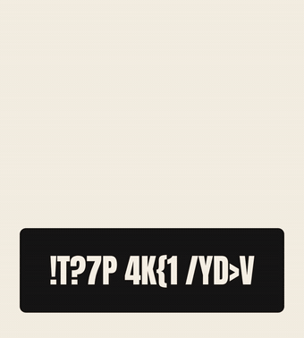

<p align="center">
  
</p>

<p align="center">
  <b>Você manda a ideia. Um agente de código escreve o roteiro, grava a locução, anima cada cena no tempo da fala e entrega o MP4 pronto pra postar.</b>
</p>

<p align="center">
  
  
  
  
</p>

<p align="center">
  por <b>Silvio Campos</b> · <a href="https://github.com/eusilvio">github.com/eusilvio</a>
</p>

---

<table>
<tr>
<td width="44%" valign="top">



</td>
<td width="56%" valign="top">

### Em cena

Pedir "faz um vídeo bonito" gera animação aleatória que não conversa com a fala. O motion-cena trabalha como uma produtora pequena: primeiro decide **qual história**, **em qual formato** e **o que cada cena mostra**. Só depois anima.

- **A fala manda no tempo.** A locução sai antes da animação. Cada palavra ganha um timestamp e cada ênfase dispara no quadro exato em que a palavra é dita.
- **Uma ideia visual por vídeo.** Cada peça nasce de um dispositivo próprio (uma carteirinha, um painel, uma página) escolhido entre três conceitos, e o sistema veta o que repetir vídeos anteriores.
- **Cada etapa grava um arquivo.** Dá para parar, revisar e pedir só o pedaço que mudou: "troca o hook", "faz a versão pra story".
- **Nada fica embaixo dos botões.** Um medidor percorre o vídeo a cada quarto de segundo e reprova texto, card ou logo que entra na área da interface do Reels, TikTok ou Shorts.

Ao lado: cinco dos **44 efeitos** do dicionário, renderizados pelo próprio pipeline.

</td>
</tr>
</table>

---

## Cena 01 · Monta o set

```bash
git clone https://github.com/eusilvio/motion-cena.git
cd motion-cena
./setup.sh      # confere Node, FFmpeg, uv e o agente; cria as pastas locais e o .env.local
claude          # ou codex, agy, opencode, ou abre a pasta no Cursor, Windsurf ou VS Code com Copilot
```

Precisa de **Node 22+**, **FFmpeg**, **[uv](https://docs.astral.sh/uv/)** e um agente de código. Sem chave nenhuma o pipeline roda inteiro: voz grátis pelo edge-tts e efeitos sonoros sintetizados na sua máquina. Com `ELEVENLABS_API_KEY` no `.env.local`, a voz sobe de nível (e dá pra clonar a sua).

## Cena 02 · Faz o pedido

Fala com o agente como falaria com um editor:

| Você pede | Sai |
|---|---|
| *"Faz um reels de 30 s explicando juros compostos. Pesquisa os fatos."* | pesquisa com fonte, roteiro com 3 hooks, locução, animação e o MP4 de Reels e TikTok |
| *"Transforma esse PDF num vídeo de dados no estilo do meu site."* | os melhores números do relatório, com a página de origem, nas cores e fontes do site |
| *"Analisa o app em ../loja e faz um vídeo de 40 s do produto."* | fatos, telas e marca tirados do próprio código (sem ler `.env` nem dado de produção) |
| *"Anima em cima desse vídeo em que eu falo, com legenda palavra por palavra."* | a sua gravação como base, com legenda, palavra-chave e cards no ritmo da fala |
| *"Faz em carrossel de 7 slides."* | capa com gancho, um slide por ideia, PNG por slide, legenda e texto alternativo |
| *"Título entra com slide in em 0,4 s ease out, benefícios com stagger de 0,15 s."* | exatamente isso: o dicionário traduz cada termo em código |

Depois é iterar: *"troca pelo hook B"*, *"tira a música"*, *"divide em 3 stories"*, *"faz a versão pro YouTube"*.

## Cena 03 · Do pedido ao MP4


Cada caixa grava um arquivo em `projects/<slug>/` (`brief.md`, `plan.md`, `storyboard.json`, `brand.json`, `audio/words.json`, `timeline.json`, `video/`, `audio/mix.wav`) e o vídeo final sai em `creatives/reels/<slug>-<plataforma>.mp4`.

## Cena 04 · Assiste à edição ao vivo (se quiser)

O ao vivo é opcional. Peça *"quero ver ao vivo"* e, na etapa de animação, o agente abre o **HyperFrames Studio** assim que existe a primeira cena. Sem pedir, ele trabalha quieto e entrega o MP4. O Studio recarrega a cada arquivo salvo: você vê o vídeo se montar cena por cena, com timeline, play e edição manual. Clicou num elemento e disse "muda isso"? O agente lê a seleção do Studio e sabe exatamente o que você apontou.

Quer chat e vídeo na mesma tela? Sobe a interface do projeto:

```bash
node tools/studio/server.mjs        # abre http://127.0.0.1:4400
```

| Esquerda | Direita | Topo |
|---|---|---|
| chat com Claude Code, Codex ou Antigravity, com cada comando e arquivo aparecendo na hora | o Studio do projeto em edição, mais abas de roteiro, storyboard e vídeo final | as etapas do pipeline acendendo conforme os arquivos aparecem |

> A interface escuta só em `127.0.0.1`, exige um token por execução e roda o agente **com aprovação automática** (uma página web não tem como responder aos pedidos de permissão dele). Use na sua máquina, em repositórios em que você confia.

## Cena 05 · Qualquer agente

O pipeline é texto e linha de comando. Qualquer agente que lê arquivos e roda comandos no terminal consegue dirigir.

| Arquivo | Para quem |
|---|---|
| `AGENTS.md` | Codex, Antigravity, Cursor, GitHub Copilot, OpenCode, Windsurf, Amp, Zed e a maioria dos agentes |
| `CLAUDE.md` · `GEMINI.md` | só importam o `AGENTS.md` para o Claude Code e o Gemini CLI |
| `.agents/skills/` | a skill `motion-cena` e as skills oficiais do HyperFrames, na pasta padrão entre agentes |
| `.claude/skills/` | links para `.agents/skills/`, criados pelo `setup.sh` ou pelo próprio Claude na primeira sessão |

Ferramenta que só existe num agente (Claude Design, conector MCP) é opcional: a skill sempre descreve o caminho que funciona em qualquer um.

## Cena 06 · Cada vídeo com a cara dele

O repositório sai zerado: nenhuma marca, voz ou persona de ninguém. A identidade vem do pedido.

| Você manda | Marca | Voz e tom |
|---|---|---|
| site, cores, fontes ou logo | extraída do que veio | os do pedido |
| o código do produto | tema, tokens, fontes e logo do repositório | a copy real do app |
| uma gravação de alguém falando | só se vier no pedido | a voz é a da gravação, sem regravar |
| *"mesma marca do projeto X"* | copiada do projeto X | as do brief de X |
| nada | direção visual própria, nascida da ideia do vídeo | o tom natural do gênero |

---

## Bastidores

<details>
<summary><b>O que dá pra mandar</b> · nove modos de entrada</summary>

| Modo | Você manda | O que acontece |
|---|---|---|
| **Roteiro** (padrão para texto seu) | um texto ou roteiro | vira roteiro de vídeo: mantém fatos, intenção e as frases com a sua voz; ajusta duração, hook, ouvido e fecho |
| **Narração literal** | texto + "usa exatamente como está" | palavra por palavra; ajuste de pronúncia só num arquivo separado para o TTS |
| **Notas** | tópicos, bullets, transcrição | organiza em história, escolhe formato, escreve o roteiro |
| **Tema** | só o assunto | pesquisa na web com fontes, depois roteiro |
| **Fonte longa** | PDF, relatório, artigo, URL | lê tudo e extrai os melhores trechos com a página de origem |
| **Dados** | planilha, CSV, números | acha a história nos números; cada número ganha um visual |
| **Áudio gravado** | uma locução | transcreve com timestamps e anima em cima dessa voz |
| **Vídeo gravado** | alguém falando (talking head, palestra, entrevista) | a imagem e a voz são a base; o motion entra por cima |
| **Código** | caminho ou repositório de um produto | fatos, telas e marca saem do código |

Texto maior que a plataforma permite? O sistema avisa e oferece dividir em partes, condensar ou trocar de plataforma. Nunca corta em silêncio.
</details>

<details>
<summary><b>Gêneros</b> · estrutura e linguagem de cada tipo de vídeo</summary>

| Gênero | Estrutura | Visual e motion |
|---|---|---|
| **História** | conflito → personagem → obstáculo → virada → fecho | metáfora visual recorrente, match cut, push-in lento |
| **Motivacional** | frase-choque → dor reconhecível → reenquadre → chamada | tipografia cinética grande (slam, line reveal), uma ideia por tela, punch zoom nos picos |
| **Técnico** | resultado → passos numerados → armadilha → recapitulação | UI e código com typewriter e highlight, setas draw-on |
| **Explicativo** | pergunta → analogia → mecanismo → exemplo → síntese | diagrama que se monta (draw-on, stagger, morph) |
| **Dados / notícia** | número-gancho → contexto → contraste → implicação | count-up, bar grow, comparação lado a lado |
| **Produto** | dor → solução → 3 benefícios → prova → CTA | pop in, stagger de benefícios, punch zoom no produto, wipe na cor da marca |
| **Opinião** | tese → argumentos → objeção → conclusão | texto-chave grande, split screen, mito × verdade |

Formatos narrativos: comparação, transformação, experimento, tutorial, listicle, ranking, mito × verdade, previsão, bastidores, história de personagem, pergunta aberta, manifesto, explicação por analogia.
</details>

<details>
<summary><b>Plataformas</b> · presets, durações e zonas seguras</summary>

Cada plataforma é um preset em `assets/platforms.json`, tirado das documentações oficiais (out/2026).

| Preset | Plataforma | Canvas | Máx. | Ideal | Zona segura (topo / base / laterais) |
|---|---|---|---|---|---|
| `ig-stories` | Instagram Stories | 1080×1920 | 60 s por story | 5–15 s | 269 / 672 / 65 |
| `ig-reels` | Instagram Reels | 1080×1920 | 3 min | 15–60 s | 269 / 672 / 65 |
| `ig-feed` | Instagram Feed | 1080×1350 | 3 min | 15–60 s | 60 |
| `fb-reels` | Facebook Reels | 1080×1920 | 3 min | 15–60 s | 269 / 672 / 65 |
| `vertical` | Reels + TikTok + Shorts | 1080×1920 | 3 min | 15–60 s | 288 / 672 / 65 esq. · 192 dir. |
| `tiktok` | TikTok | 1080×1920 | 10 min | 15–60 s | 160 / 480 / 60 esq. · 140 dir. |
| `yt-shorts` | YouTube Shorts | 1080×1920 | 3 min | 20–60 s | 200 / 480 / 60 esq. · 140 dir. |
| `yt-long` | YouTube horizontal | 1920×1080 | sem limite | 1–15 min | 54 / 140 / 96 |
| `yt-long-4k` | YouTube 4K | 3840×2160 | sem limite | 1–15 min | 108 / 280 / 192 |
| `linkedin` | LinkedIn | 1080×1350 | 15 min | 30–90 s | 60 |
| `square` | Feed genérico / X | 1080×1080 | sem limite | 15–60 s | 60 |

Saída comum: MP4 H.264 `yuv420p`, frame rate constante, AAC 48 kHz, `+faststart`, −14 LUFS. Uma narração e uma timeline geram todas as versões; só o layout é recomposto.
</details>

<details>
<summary><b>Carrossel</b> · a mesma ideia em slides, sem narração</summary>

Liga com "faz em carrossel" (ou "faz o vídeo e o carrossel"). O fluxo vira brief → plano de slides → design → export.

| Motor | Entrega |
|---|---|
| **Local** (qualquer agente) | `creatives/carrossel/<slug>-ig-carousel/01.png … NN.png`, `contact.jpg` e `carousel.pdf` para LinkedIn |
| **Claude Design** (agente Claude com Artifact) | canvas editável no claude.ai, uma prancheta por slide |

Presets `ig-carousel` (1080×1350), `ig-carousel-square` (1080×1080) e `linkedin-carousel` (PDF). Junto saem `legenda.txt` e `alt-text.txt`.
</details>

<details>
<summary><b>Dicionário de efeitos</b> · 44 termos com receita pronta</summary>

`references/motion-dictionary.md` é o vocabulário entre você, o storyboard e o código. Cada efeito tem definição, duração e ease padrão e código GSAP seguro para render. A fórmula para pedir: **efeito + duração + ease + alvo**.

| Família | Efeitos |
|---|---|
| Entradas | fade in, slide in, blur in, pop in, scale up, stagger |
| Ritmo | ease in-out, overshoot, bounce |
| Texto | typewriter, word reveal, text swap, scramble, line reveal, highlight, slam, count-up |
| Formas | draw-on, morph, bar grow |
| Ênfase | pulse, shake, glow, wiggle |
| Física | anticipation, squash & stretch, follow-through, float |
| Câmera | push-in, parallax, whip pan, dolly zoom |
| Transições | mask reveal, wipe, punch zoom, zoom through, iris, push, glitch, flash, blinds, match cut |
| Acabamento | motion trail, grain |

Todos renderizados em `creatives/demos/` (fonte em `training/dicionario-demo*/`).
</details>

<details>
<summary><b>Símbolos reais e texto limpo</b> · bandeira de verdade, logo de verdade, sem cara de IA</summary>

Antes do storyboard o sistema lê cada frase e escolhe um visual que conte a mesma coisa sem o áudio, na ordem: símbolo real → objeto concreto → foto livre → dado → metáfora → tipografia.

| Menção | Símbolo | Comando |
|---|---|---|
| país | bandeira oficial | `fetch_icon.py flag jp` |
| prêmio | medalha na cor do metal | `icon medal --weight fill --color "#D4A72C"` |
| ação, pessoa | silhueta CC0 na cor da marca | `image runner --category illustration --license cc0,pdm` |
| empresa, app | logo oficial | `logo spotify` |
| objeto | ícone de linha | `icon cloud-rain` |

Licença de cada símbolo vai para o `CREDITS.md` do projeto. Emoji não entra em peça nenhuma, e o `lint_copy.py` barra frase de efeito simétrica, isca de curiosidade e travessão dramático no roteiro, nos slides e na legenda.
</details>

<details>
<summary><b>Estilos de referência</b> · mande um vídeo que você curtiu</summary>

Copie o vídeo para `training/referencias/ref-01.mp4` e peça *"analisa esse vídeo e cria um estilo"*. O sistema quebra a peça em pranchas com timecode, mede a fala e o loudness e escreve uma receita em `references/styles/<nome>.md` (modelo em `_template.md`). Depois é só pedir *"faz no estilo <nome>"*: a receita empresta a gramática, e marca, texto e números continuam sendo os seus.

As receitas ficam só na sua máquina, porque são análise da peça de outra pessoa.
</details>

<details>
<summary><b>Scripts</b> · o que roda por baixo</summary>

Em `.agents/skills/motion-cena/scripts/`, todos com `uv run` (dependências declaradas no próprio arquivo).

| Script | Faz |
|---|---|
| `platform_preset.py` | mostra presets (`--list`, `--css` com as variáveis de zona segura) |
| `tts_edge.py` · `tts_elevenlabs.py` | locução com timestamp por palavra (grátis ou ElevenLabs, com clonagem de voz) |
| `align_words.py` | timestamps por palavra de qualquer áudio (faster-whisper) |
| `build_timeline.py` | ancora cenas e ênfases nas palavras faladas → `timeline.json` |
| `synth_sfx.py` · `mix_audio.py` | kit de efeitos sintetizado e mix com ducking a −14 LUFS |
| `fetch_icon.py` · `asset_library.py` | símbolos reais com licença e biblioteca do que já foi produzido |
| `analyze_reference.sh` | pranchas, frames-chave, fala e loudness de um vídeo de referência |
| `isolate_voice.py` | tira música e ruído de uma gravação |
| `lint_copy.py` | aponta texto com cara de IA |
| `dc_to_carousel.py` · `render_carousel.py` | carrossel em PNG e PDF |
| `safe_zone_check.py` | percorre o vídeo e reprova o que entra na zona da interface da plataforma |
| `qa_video.sh` | checa canvas, fps, duração, codec e loudness, e gera a contact sheet com a zona pintada |
</details>

<details>
<summary><b>Mapa do repositório</b> · e o que nunca vai para o git</summary>

```
motion-cena/
├── AGENTS.md · CLAUDE.md · GEMINI.md   # entrada para qualquer agente
├── setup.sh                            # prepara a máquina
├── tools/studio/                       # chat + Studio ao vivo
├── .agents/skills/
│   ├── motion-cena/                    # a skill: SKILL.md, references/, assets/, scripts/
│   └── hyperframes*/, media-use/       # motor de animação (HyperFrames)
├── docs/                               # banner e GIF deste README
├── training/dicionario-demo*/          # composições que validam os 44 efeitos
├── creatives/demos/                    # os efeitos renderizados
├── projects/<slug>/                    # seus projetos em produção          (local)
└── creatives/{reels,carrossel,post}/   # suas peças finais                   (local)
```

Fica sempre fora do git: `projects/*`, suas peças em `creatives/`, `training/voz` (dado biométrico), `training/referencias` (vídeo de terceiros), as receitas de estilo, `.env.local` e as configurações locais de cada agente. Quer versionar suas peças? Crie um repositório **privado** só para elas.
</details>

---

## Créditos

Criado por **Silvio Campos** ([@eusilvio](https://github.com/eusilvio)).

- Código, skill `motion-cena` e documentação: [MIT](LICENSE).
- Motor de animação: skills oficiais do [HyperFrames](https://github.com/heygen-com/hyperframes) (Apache-2.0, em [`.agents/skills/HYPERFRAMES-LICENSE`](.agents/skills/HYPERFRAMES-LICENSE)). `talking-head-recut` adapta o vtake-skills (MIT).
- Vocabulário da parte 1 do dicionário inspirado no carrossel "Dicionário de efeitos Motion" (@omatheusdaia).
- Fontes das demos (Anton, Inter, JetBrains Mono): SIL Open Font License.
- Ícones, logos e imagens baixados por `fetch_icon.py` mantêm a licença de cada fonte. Logo de marca é marca registrada do dono.

<p align="center"><sub>motion-cena · cena 01, tomada 1</sub></p>
