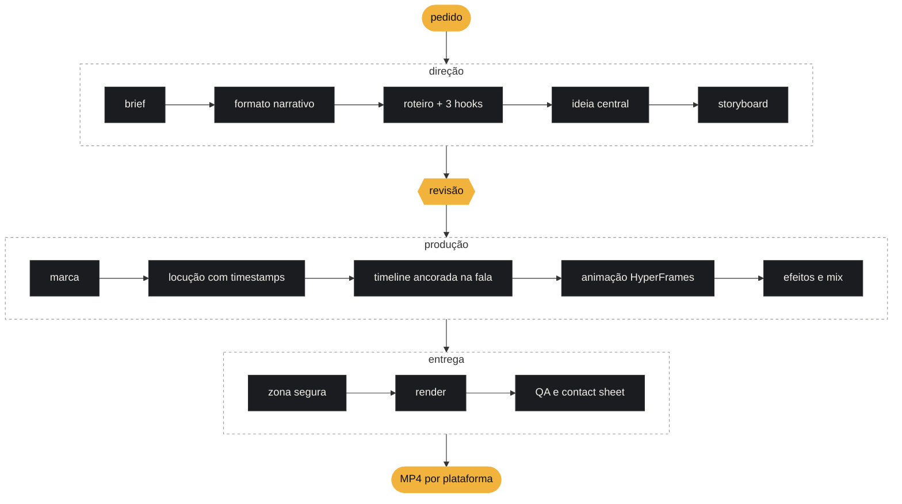

<p align="center">
  
</p>

<p align="center">
  <b>Você manda a ideia. Um agente de código escreve o roteiro, grava a locução, anima cada cena no tempo da fala e entrega o MP4 pronto pra postar.</b>
</p>

<p align="center">
  
  
  
  
  <a href="https://github.com/eusilvio/motion-cena/actions/workflows/ci.yml"></a>
</p>

<p align="center">
  por <b>Silvio Campos</b> · <a href="https://github.com/eusilvio">github.com/eusilvio</a>
</p>

<p align="center">
  <b>Português</b> · <a href="README.en.md">English</a>
</p>

---

<table>
<tr>
<td width="44%" valign="top">


</td>
<td width="56%" valign="top">

### Em cena

Pedir "faz um vídeo bonito" gera animação aleatória que não conversa com a fala. O motion-cena trabalha como uma produtora pequena: primeiro decide **qual história**, **em qual formato** e **o que cada cena mostra**. Só depois anima.

- **A fala manda no tempo.** A locução sai antes da animação. Cada palavra ganha um timestamp e cada ênfase dispara no quadro exato em que a palavra é dita.
- **Uma ideia visual por vídeo.** Cada peça nasce de um dispositivo próprio (uma carteirinha, um painel, uma página) escolhido entre três conceitos, e o sistema veta o que repetir vídeos anteriores.
- **Cada etapa grava um arquivo.** Dá para parar, revisar e pedir só o pedaço que mudou: "troca o hook", "faz a versão pra story".
- **Nada fica embaixo dos botões.** Um medidor percorre o vídeo a cada quarto de segundo e reprova texto, card ou logo que entra na área da interface do Reels, TikTok ou Shorts.

Ao lado: cinco dos **44 efeitos curados** do dicionário, renderizados pelo próprio pipeline. O catálogo completo tem **388**.

</td>
</tr>
</table>

---

## Cena 01 · Monta o set

```bash
git clone https://github.com/eusilvio/motion-cena.git
cd motion-cena
./setup.sh      # confere Node, FFmpeg, uv e o agente; cria as pastas locais e o .env.local
claude          # ou codex, agy, opencode, ou abre a pasta no Cursor, Windsurf ou VS Code com Copilot
```

Precisa de **Node 22+**, **FFmpeg**, **[uv](https://docs.astral.sh/uv/)** e um agente de código. Sem chave nenhuma o pipeline roda inteiro: voz grátis pelo edge-tts e efeitos sonoros sintetizados na sua máquina. Com `ELEVENLABS_API_KEY` no `.env.local`, a voz sobe de nível (e dá pra clonar a sua).

### No Windows

Use o **WSL 2**: o pipeline roda inteiro, igual no Linux. O `setup.ps1` prepara a pasta pelo PowerShell, mas no Windows nativo parte do fluxo não roda (limites no fim do passo a passo).

<details>
<summary><b>Passo a passo</b> · WSL 2 ou PowerShell</summary>

#### WSL 2 (recomendado)

1. Abra o PowerShell como administrador, instale o Ubuntu e reinicie o computador:

   ```powershell
   wsl --install -d Ubuntu-24.04
   ```

   Depois de reiniciar, abra **Ubuntu** no menu Iniciar e crie seu usuário e senha. Todos os comandos abaixo rodam nesse terminal.

2. Instale FFmpeg, Git, Node (pelo nvm) e uv:

   ```bash
   sudo apt update && sudo apt install -y git ffmpeg
   curl -o- https://raw.githubusercontent.com/nvm-sh/nvm/v0.40.8/install.sh | bash
   curl -LsSf https://astral.sh/uv/install.sh | sh
   exec bash                 # recarrega o terminal com nvm e uv no PATH
   nvm install --lts
   ```

3. Instale as bibliotecas do Chromium (o render e o medidor de zona segura usam um Chrome sem janela):

   ```bash
   uvx playwright install --with-deps chromium
   ```

4. Clone **dentro da sua pasta do Linux**, não em `/mnt/c`. Em `/mnt/c` cada acesso a arquivo atravessa para o Windows: `npx` e render ficam bem mais lentos, e o preview ao vivo não percebe arquivos editados por programas do Windows.

   ```bash
   cd ~
   git clone https://github.com/eusilvio/motion-cena.git
   cd motion-cena
   ./setup.sh
   npx hyperframes doctor    # confere Chrome e FFmpeg
   ```

5. Instale e abra seu agente no mesmo terminal, na raiz do projeto (`claude`, `codex`, `opencode` ou outro). No VS Code ou no Cursor, rode `code .` ou `cursor .` aqui dentro: o editor abre conectado ao WSL.

Para ver os vídeos prontos no Windows, rode `explorer.exe creatives` ou abra `\\wsl.localhost\Ubuntu-24.04\home\<seu-usuário>\motion-cena` no Explorer. Se você clonou pelo Windows antes e o `./setup.sh` falha com `bash\r`, clone de novo dentro do WSL.

#### PowerShell nativo

```powershell
winget install Git.Git
winget install OpenJS.NodeJS.LTS
winget install Gyan.FFmpeg
winget install astral-sh.uv
# feche e abra o terminal para o PATH novo valer
git clone https://github.com/eusilvio/motion-cena.git
cd motion-cena
powershell -ExecutionPolicy Bypass -File .\setup.ps1
```

O `setup.ps1` faz o mesmo que o `setup.sh` e avisa o que falta. Em `.claude\skills` ele cria junctions, que não pedem administrador. Se você mover a pasta do projeto, rode o `setup.ps1` de novo.

Limites no Windows nativo:

- `qa_video.sh` e `analyze_reference.sh` são scripts bash. O Claude Code roda os dois pelo Git Bash quando o Git for Windows está instalado. Agentes que executam comandos no PowerShell (Codex, Gemini CLI, Copilot CLI) não rodam.
- A interface `tools/studio` não roda no Windows nativo.
- Se o PowerShell disser que a execução de scripts está desabilitada ao rodar `npx`, libere para o seu usuário: `Set-ExecutionPolicy -Scope CurrentUser RemoteSigned`.
</details>

## Cena 02 · Faz o pedido

Fala com o agente como falaria com um editor:

| Você pede | Sai |
|---|---|
| *"Faz um reels de 30 s explicando juros compostos. Pesquisa os fatos."* | pesquisa com fonte, roteiro com 3 hooks, locução, animação e o MP4 de Reels e TikTok |
| *"Transforma esse PDF num vídeo de dados no estilo do meu site."* | os melhores números do relatório, com a página de origem, nas cores e fontes do site |
| *"Analisa o app em ../loja e faz um vídeo de 40 s do produto."* | fatos, telas e marca tirados do próprio código (sem ler `.env` nem dado de produção) |
| *"Anima em cima desse vídeo em que eu falo, com legenda palavra por palavra."* | a sua gravação como base, com legenda, palavra-chave e cards no ritmo da fala |
| *"Faz em carrossel de 7 slides."* | capa com gancho, um slide por ideia, PNG por slide, legenda e texto alternativo |
| *"Título entra com slide in em 0,4 s ease out, benefícios com stagger de 0,15 s."* | exatamente isso: o dicionário traduz cada termo em código |

Depois é iterar: *"troca pelo hook B"*, *"tira a música"*, *"divide em 3 stories"*, *"faz a versão pro YouTube"*.

## Cena 03 · Quanto leva e quanto custa

Números de produções reais feitas com este repositório no Claude Code (Opus 5.5), entre 20/10 e 04/11/2026, num notebook comum. Servem de ordem de grandeza: os seus vão variar.

| Peça | Voz | Até a 1ª entrega | Com os ajustes | Tokens no total | Custo equivalente na API | Render |
|---|---|---|---|---|---|---|
| Reels de 30 s a partir do código de um produto | ElevenLabs | 30 min | 42 min (1 ajuste) | 24,8 M | US$ 10,58 (US$ 8,37 na 1ª entrega) | 2 min 18 s |
| Reels de 46 s a partir do código de um produto, com trilha | ElevenLabs (voz e trilha) | 25 min | 41 min (1 ajuste) | 25,2 M | US$ 12,18 (US$ 8,03 na 1ª entrega) | 2 min 20 s a 2 min 32 s |
| Carrossel de 6 slides a partir de um texto pronto, com checagem dos números na web | sem voz | 3 min | 7 min (2 ajustes) | 8,5 M | US$ 3,22 (US$ 1,24 na 1ª entrega) | 5 s (PNG) |

Os minutos contam o tempo em que o agente estava trabalhando, do seu pedido até a última ação dele. O tempo que você leva para olhar e responder fica fora. Cada rodada de ajuste nos vídeos somou de 12 a 16 min e de 8 a 10 M tokens (US$ 2 a 4). Em todos os casos, 98 % dos tokens foram leitura de cache, a parte mais barata.

**Para gastar menos:** faça uma peça por sessão. A cada pedido o agente relê a conversa inteira, e nas sessões medidas a segunda peça na mesma conversa custou de 35 % a 41 % da sessão. Ao terminar um vídeo, abra uma sessão nova (`/clear` no Claude Code): tudo fica gravado em `projects/<slug>/` e o agente continua de onde parou. Conectores e plugins que você não usa para vídeo também pesam em todo pedido; desligue-os neste projeto.

<details>
<summary><b>Cada etapa medida, voz e plano do Claude</b></summary>

Medido num Intel i5-8265U de 4 núcleos, 11,6 GB de RAM, sem GPU dedicada, Linux:

| Etapa | Tempo |
|---|---|
| Render de 30,5 s em 1080×1920 a 30 fps (`npx hyperframes render`, qualidade padrão) | 1 min 50 s, uns 5 núcleos ocupados e 1,5 GB de RAM a mais |
| O mesmo render com `--quality draft` (para iterar) | 1 min 22 s |
| Locução com edge-tts, 77 palavras em pt-BR (23 s de áudio) | 3 s (9 s na primeira vez, enquanto o `uv` instala a dependência) |
| Zona segura (`safe_zone_check.py`) + QA (`qa_video.sh`) | 21 s + 7 s |
| Exportar carrossel de 6 a 8 slides em PNG | 5 a 10 s |

**Voz.** O edge-tts é grátis. Na ElevenLabs, uma locução de 30 s tem de 415 a 495 caracteres (82 a 96 palavras). A US$ 0,08 por 1.000 caracteres nos modelos multilingual v2, v3 e v4, cada geração custa uns US$ 0,04, e o plano Starter (US$ 6/mês, 75.000 caracteres nesses modelos) cobre umas 150 locuções de 30 s. A trilha pelo Eleven Music sai a US$ 0,15 por minuto ([preços da API da ElevenLabs](https://elevenlabs.io/pricing/api), consultados em 04/11/2026).

**O plano Pro dá conta?** Pro (US$ 20/mês) e Max (US$ 100/mês, com cinco vezes o uso do Pro) incluem o Claude Code. Os dois têm um limite por sessão de 5 horas e um limite semanal, compartilhados entre o Claude e o Claude Code, e a Anthropic não publica quantos tokens cabem em cada janela ([Claude Code no Pro e no Max](https://support.claude.com/en/articles/11145838-use-claude-code-with-your-pro-or-max-plan), [como os limites funcionam](https://support.claude.com/en/articles/11647753-how-do-usage-and-length-limits-work), [plano Max](https://support.claude.com/en/articles/11049741-what-is-the-max-plan), consultados em 04/11/2026). Ninguém testou ainda no Pro, então não dá para prometer quantos vídeos cabem nele. Acompanhe as barras com `/usage` no Claude Code. Se o limite chegar no meio de um vídeo, ative os créditos de uso ou continue depois do reset: cada etapa fica gravada em `projects/<slug>/` e o agente retoma de onde parou.

Limites destes números:

- Só Claude Code, com Opus 5.5 (esforço `xhigh` nos dois vídeos, `medium` no carrossel). Codex, Antigravity, Cursor e os outros contam uso de outro jeito e não foram medidos.
- "Custo equivalente na API" é tokens × preço de tabela do Opus 5.5 (por milhão: US$ 4 entrada, US$ 8 escrita de cache de 1 h, US$ 0,20 leitura de cache, US$ 20 saída). Quem usa plano não paga isso por vídeo; o número serve para comparar.
- Mais rodadas de ajuste, sessão longa (todo pedido relê o histórico, então um vídeo por sessão sai mais barato), repositório grande para ler, pesquisa na web e esforço mais alto aumentam tokens e minutos.
- O render rodou só na CPU, com outras sessões abertas na mesma máquina, então os tempos estão um pouco pessimistas. Composições com fotos em tela cheia, desfoque e granulação demoram bem mais (uma de 62 s levou 6 min 20 s).
</details>

Medições em outras máquinas e agentes são bem-vindas: abra uma issue com os seus números.

## Cena 04 · Do pedido ao MP4



Cada caixa grava um arquivo em `projects/<slug>/` (`brief.md`, `plan.md`, `storyboard.json`, `brand.json`, `audio/words.json`, `timeline.json`, `video/`, `audio/mix.wav`) e o vídeo final sai em `creatives/reels/<slug>-<plataforma>.mp4`.

## Cena 05 · Assiste à edição ao vivo (se quiser)

O ao vivo é opcional. Peça *"quero ver ao vivo"* e, na etapa de animação, o agente abre o **HyperFrames Studio** assim que existe a primeira cena. Sem pedir, ele trabalha quieto e entrega o MP4. O Studio recarrega a cada arquivo salvo: você vê o vídeo se montar cena por cena, com timeline, play e edição manual. Clicou num elemento e disse "muda isso"? O agente lê a seleção do Studio e sabe exatamente o que você apontou.

Quer chat e vídeo na mesma tela? Sobe a interface do projeto:

```bash
node tools/studio/server.mjs        # abre http://127.0.0.1:4400
```

| Esquerda | Direita | Topo |
|---|---|---|
| chat com Claude Code, Codex ou Antigravity, com cada comando e arquivo aparecendo na hora | o Studio do projeto em edição, mais abas de roteiro, storyboard e vídeo final | as etapas do pipeline acendendo conforme os arquivos aparecem |

> A interface escuta só em `127.0.0.1`, exige um token por execução e roda o agente **com aprovação automática** (uma página web não tem como responder aos pedidos de permissão dele). Use na sua máquina, em repositórios em que você confia.

## Cena 06 · Qualquer agente

O pipeline é texto e linha de comando. Qualquer agente que lê arquivos e roda comandos no terminal consegue dirigir.

| Arquivo | Para quem |
|---|---|
| `AGENTS.md` | Codex, Antigravity, Cursor, GitHub Copilot, OpenCode, Windsurf, Amp, Zed e a maioria dos agentes |
| `CLAUDE.md` · `GEMINI.md` | só importam o `AGENTS.md` para o Claude Code e o Gemini CLI |
| `.agents/skills/` | a skill `motion-cena` e as skills oficiais do HyperFrames, na pasta padrão entre agentes |
| `.claude/skills/` | links só para as 6 skills que o pipeline usa (lista em `.agents/skills/claude-links.txt`), criados pelo `setup.sh` ou pelo próprio Claude na primeira sessão. Cada skill linkada manda a descrição em todo pedido |

Ferramenta que só existe num agente (Claude Design, conector MCP) é opcional: a skill sempre descreve o caminho que funciona em qualquer um.

## Cena 07 · Cada vídeo com a cara dele

O repositório sai zerado: nenhuma marca, voz ou persona de ninguém. A identidade vem do pedido.

| Você manda | Marca | Voz e tom |
|---|---|---|
| site, cores, fontes ou logo | extraída do que veio | os do pedido |
| o código do produto | tema, tokens, fontes e logo do repositório | a copy real do app |
| uma gravação de alguém falando | só se vier no pedido | a voz é a da gravação, sem regravar |
| *"mesma marca do projeto X"* | copiada do projeto X | as do brief de X |
| nada | direção visual própria, nascida da ideia do vídeo | o tom natural do gênero |

## Deu erro?

Rode primeiro os dois diagnósticos. O `setup.sh` aponta o que falta (Node, FFmpeg, uv) e o `doctor` do HyperFrames confere Node, FFmpeg, Chrome, memória e disco:

```bash
./setup.sh
npx hyperframes doctor
```

No `doctor`, falha em `TTS (Kokoro)` ou `BGM (MusicGen)` pode ser ignorada (é por causa delas que ele termina com "Some checks failed" mesmo com tudo certo): são alternativas locais opcionais e o motion-cena não depende delas.

<details>
<summary><b>O render demora, para no meio ou some</b></summary>

**Sintoma.** Uma destas mensagens, ou um vídeo que nunca aparece:

```
Command did not complete within its 600s timeout and was moved to the background
Render cancelled: render_cancelled_parent_exited
Background command "..." was stopped because the system is running low on memory
```

Às vezes sobra uma pasta `creatives/reels/work-*/` com um `video-only.mp4` que o `ffprobe` recusa com `moov atom not found`.

**Causa.** Um vídeo de 30 s leva de 1,5 a 2,5 min para renderizar num notebook comum, e composições pesadas (fotos em tela cheia, desfoque, granulação) passam de 6 min. Quando o comando do agente termina ou estoura o tempo, o HyperFrames cancela o render junto. Com outros renders ou previews do Studio abertos, a memória acaba.

**Solução.** Feche o que está aberto e rode o render desacoplado do agente, com menos workers:

```bash
npx hyperframes preview --list                 # previews do Studio ainda rodando
npx hyperframes preview --stop                 # dentro da pasta do projeto que não precisa mais dele
cd projects/<slug>/video
bash -c 'set -m; HYPERFRAMES_RENDER_DETACHED=1 npx hyperframes render -o ../../../creatives/reels/<slug>-ig-reels.mp4 --workers 2 < /dev/null > ../out/render.log 2>&1 &'
tail -f ../out/render.log                      # termina com "rendered in ..."
```

Enquanto ajusta, use `--quality draft` (aqui, 1 min 22 s em vez de 1 min 50 s para 30 s de vídeo). Apague a pasta `creatives/reels/work-*` que o render interrompido deixou.
</details>

<details>
<summary><b>Chrome do render não encontrado (HyperFrames)</b></summary>

**Sintoma.**

```
[BrowserManager] Chrome binary not found at ... Run `hyperframes browser ensure` to re-download.
```

ou um aviso de que o arquivo do Chrome está danificado.

**Causa.** O HyperFrames renderiza com um Chrome próprio (uns 260 MB em `~/.cache/hyperframes/chrome`). O download do primeiro render falhou, foi interrompido ou o cache foi apagado.

**Solução.**

```bash
npx hyperframes browser ensure          # baixa o Chrome fixado pelo HyperFrames
npx hyperframes browser ensure --force  # apaga um download quebrado e baixa de novo
npx hyperframes browser path            # mostra qual executável está sendo usado
```
</details>

<details>
<summary><b>Chrome do medidor de zona segura (Playwright)</b></summary>

**Sintoma.** O `safe_zone_check.py` para com:

```
BrowserType.launch: Executable doesn't exist at .../ms-playwright/chromium_headless_shell-.../chrome-headless-shell
Looks like Playwright was just installed or updated.
Please run the following command to download new browsers:
    playwright install
```

**Causa.** O medidor usa o Playwright, que tem um Chromium separado do HyperFrames. O script tenta esse Chromium e depois um Google Chrome instalado no sistema. Sem nenhum dos dois, ele para.

**Solução.**

```bash
uv run --with playwright playwright install chromium
```

Num Linux sem as bibliotecas do navegador, acrescente `--with-deps` (pede sudo). Para ver o que vai baixar antes: `--dry-run`.
</details>

<details>
<summary><b>edge-tts não gera áudio</b></summary>

**Sintoma.**

```
edge_tts.exceptions.NoAudioReceived: No audio was received. Please verify that your parameters are correct.
```

**Causa.** Nome de voz errado, sem internet ou versão do edge-tts desatualizada depois de uma mudança no serviço da Microsoft (o serviço é gratuito e não oficial).

**Solução.** Confira o nome da voz e force a versão mais nova:

```bash
uv run --with edge-tts edge-tts --list-voices | grep pt-BR
# pt-BR-AntonioNeural, pt-BR-FranciscaNeural, pt-BR-ThalitaMultilingualNeural
uv run --refresh-package edge-tts .agents/skills/motion-cena/scripts/tts_edge.py --text-file projects/<slug>/narration.txt --voice pt-BR-FranciscaNeural --out projects/<slug>/audio
```

Se continuar falhando, peça a locução pela ElevenLabs.
</details>

<details>
<summary><b>ElevenLabs recusa o pedido</b></summary>

**Sintoma.** Uma destas:

```
ELEVENLABS_API_KEY not set (run: npx -y @elevenlabs/cli@latest onboard init)
status_code: 401 ... 'Neither authorization header nor xi-api-key received, please provide one.'
status_code: 400 ... 'code': 'voice_not_found'
status_code: 429 ... 'code': 'concurrent_limit_exceeded', 'message': 'Too many concurrent requests. ...'
```

**Causa.** A chave não está no `.env.local` (ou o script rodou fora do repositório); o `voice_id` pedido não existe mais na sua conta (uma voz clonada que foi apagada, por exemplo); ou o agente disparou mais gerações em paralelo do que o seu plano permite.

**Solução.** Coloque `ELEVENLABS_API_KEY=...` no `.env.local` da raiz e liste as vozes que a sua conta enxerga:

```bash
uv run .agents/skills/motion-cena/scripts/tts_elevenlabs.py --list-voices
```

No 429, peça para o agente gerar uma locução de cada vez.
</details>

<details>
<summary><b>Node, FFmpeg ou uv faltando ou na versão errada</b></summary>

**Sintoma.**

```
HyperFrames requires Node.js >= 22 (current: v20...). Switch Node versions and retry.
[FFmpeg] ffmpeg not found
Unknown encoder 'libx264'
uv: command not found
```

**Causa.** Node antigo, FFmpeg ausente ou compilado sem H.264, ou o `uv` não instalado. Os scripts de QA e mixagem chamam o `ffmpeg` do PATH, então o primeiro `ffmpeg` do PATH precisa ter `libx264` e `aac`.

**Solução.**

```bash
node -v                                             # precisa ser 22 ou maior; com nvm: nvm install 22
which -a ffmpeg                                     # qual ffmpeg vem primeiro no PATH
ffmpeg -hide_banner -encoders | grep -E ' libx264 | aac '
curl -LsSf https://astral.sh/uv/install.sh | sh     # instala o uv
```

Se o HyperFrames precisar de outro FFmpeg, aponte para ele com `HYPERFRAMES_FFMPEG_PATH` e `HYPERFRAMES_FFPROBE_PATH` e confira com `npx hyperframes doctor`.
</details>

<details>
<summary><b>O QA reprovou o vídeo</b></summary>

**Sintoma.** O `qa_video.sh` termina em `RESULT: FAIL` com uma destas linhas:

```
FAIL no silent gaps > 1.5s (found 1)
FAIL audio track none
FAIL loudness -16.55 LUFS (want -16..-12)
```

**Causa.** A primeira é a mais comum: o cartão final fica mudo depois da última palavra. A segunda aparece quando o render saiu sem o `mix.wav`. A terceira, quando a mixagem ficou baixa.

**Solução.** Encurte o cartão final ou deixe trilha e efeito embaixo dele. Para o áudio, refaça a mixagem e renderize de novo:

```bash
uv run .agents/skills/motion-cena/scripts/mix_audio.py projects/<slug>/timeline.json --voice projects/<slug>/audio/voice.mp3 --sfx-dir projects/<slug>/audio/sfx --lufs -14 --out projects/<slug>/audio/mix.wav
```
</details>

Também apareceu, com menos frequência:

- `Prompt is too long` numa sessão de 16 horas: rode `/compact` ou abra uma sessão nova por vídeo. Cada etapa fica gravada em `projects/<slug>/`, então o agente retoma de onde parou.
- `[Compiler] WARNING: Failed to download CDN script: https://cdn.jsdelivr.net/npm/gsap@.../gsap.min.js (TypeError: fetch failed)` sem internet: salve o `gsap.min.js` em `video/assets/vendor/` e aponte o `<script>` para ele.
- `Continuing render despite lint issues` é aviso, não erro. Para ver os problemas: `npx hyperframes check`.

---

## Bastidores

<details>
<summary><b>O que dá pra mandar</b> · nove modos de entrada</summary>

| Modo | Você manda | O que acontece |
|---|---|---|
| **Roteiro** (padrão para texto seu) | um texto ou roteiro | vira roteiro de vídeo: mantém fatos, intenção e as frases com a sua voz; ajusta duração, hook, ouvido e fecho |
| **Narração literal** | texto + "usa exatamente como está" | palavra por palavra; ajuste de pronúncia só num arquivo separado para o TTS |
| **Notas** | tópicos, bullets, transcrição | organiza em história, escolhe formato, escreve o roteiro |
| **Tema** | só o assunto | pesquisa na web com fontes, depois roteiro |
| **Fonte longa** | PDF, relatório, artigo, URL | lê tudo e extrai os melhores trechos com a página de origem |
| **Dados** | planilha, CSV, números | acha a história nos números; cada número ganha um visual |
| **Áudio gravado** | uma locução | transcreve com timestamps e anima em cima dessa voz |
| **Vídeo gravado** | alguém falando (talking head, palestra, entrevista) | a imagem e a voz são a base; o motion entra por cima |
| **Código** | caminho ou repositório de um produto | fatos, telas e marca saem do código |

Texto maior que a plataforma permite? O sistema avisa e oferece dividir em partes, condensar ou trocar de plataforma. Nunca corta em silêncio.
</details>

<details>
<summary><b>Gêneros</b> · estrutura e linguagem de cada tipo de vídeo</summary>

| Gênero | Estrutura | Visual e motion |
|---|---|---|
| **História** | conflito → personagem → obstáculo → virada → fecho | metáfora visual recorrente, match cut, push-in lento |
| **Motivacional** | frase-choque → dor reconhecível → reenquadre → chamada | tipografia cinética grande (slam, line reveal), uma ideia por tela, punch zoom nos picos |
| **Técnico** | resultado → passos numerados → armadilha → recapitulação | UI e código com typewriter e highlight, setas draw-on |
| **Explicativo** | pergunta → analogia → mecanismo → exemplo → síntese | diagrama que se monta (draw-on, stagger, morph) |
| **Dados / notícia** | número-gancho → contexto → contraste → implicação | count-up, bar grow, comparação lado a lado |
| **Produto** | dor → solução → 3 benefícios → prova → CTA | pop in, stagger de benefícios, punch zoom no produto, wipe na cor da marca |
| **Opinião** | tese → argumentos → objeção → conclusão | texto-chave grande, split screen, mito × verdade |

Formatos narrativos: comparação, transformação, experimento, tutorial, listicle, ranking, mito × verdade, previsão, bastidores, história de personagem, pergunta aberta, manifesto, explicação por analogia.
</details>

<details>
<summary><b>Plataformas</b> · presets, durações e zonas seguras</summary>

Cada plataforma é um preset em `assets/platforms.json`, tirado das documentações oficiais (out/2026).

| Preset | Plataforma | Canvas | Máx. | Ideal | Zona segura (topo / base / laterais) |
|---|---|---|---|---|---|
| `ig-stories` | Instagram Stories | 1080×1920 | 60 s por story | 5–15 s | 269 / 672 / 65 |
| `ig-reels` | Instagram Reels | 1080×1920 | 3 min | 15–60 s | 269 / 672 / 65 |
| `ig-feed` | Instagram Feed | 1080×1350 | 3 min | 15–60 s | 60 |
| `fb-reels` | Facebook Reels | 1080×1920 | 3 min | 15–60 s | 269 / 672 / 65 |
| `vertical` | Reels + TikTok + Shorts | 1080×1920 | 3 min | 15–60 s | 288 / 672 / 65 esq. · 192 dir. |
| `tiktok` | TikTok | 1080×1920 | 10 min | 15–60 s | 160 / 480 / 60 esq. · 140 dir. |
| `yt-shorts` | YouTube Shorts | 1080×1920 | 3 min | 20–60 s | 288 / 672 / 48 esq. · 192 dir. |
| `yt-long` | YouTube horizontal | 1920×1080 | sem limite | 1–15 min | 54 / 140 / 96 |
| `yt-long-4k` | YouTube 4K | 3840×2160 | sem limite | 1–15 min | 108 / 280 / 192 |
| `linkedin` | LinkedIn | 1080×1350 | 15 min | 30–90 s | 60 |
| `square` | Feed genérico / X | 1080×1080 | sem limite | 15–60 s | 60 |

Saída comum: MP4 H.264 `yuv420p`, frame rate constante, AAC 48 kHz, `+faststart`, −14 LUFS. Uma narração e uma timeline geram todas as versões; só o layout é recomposto.
</details>

<details>
<summary><b>Carrossel</b> · a mesma ideia em slides, sem narração</summary>

Liga com "faz em carrossel" (ou "faz o vídeo e o carrossel"). O fluxo vira brief → plano de slides → design → export.

| Motor | Entrega |
|---|---|
| **Local** (qualquer agente) | `creatives/carrossel/<slug>-ig-carousel/01.png … NN.png`, `contact.jpg` e `carousel.pdf` para LinkedIn |
| **Claude Design** (agente Claude com Artifact) | canvas editável no claude.ai, uma prancheta por slide |

Presets `ig-carousel` (1080×1350), `ig-carousel-square` (1080×1080) e `linkedin-carousel` (PDF). Junto saem `legenda.txt` e `alt-text.txt`.
</details>

<details>
<summary><b>Dicionário de efeitos</b> · 44 curados e um catálogo de 388</summary>

`references/motion-dictionary.md` é o vocabulário entre você, o storyboard e o código. Cada efeito tem definição, duração e ease padrão e código GSAP seguro para render. A fórmula para pedir: **efeito + duração + ease + alvo**.

| Família | Efeitos |
|---|---|
| Entradas | fade in, slide in, blur in, pop in, scale up, stagger |
| Ritmo | ease in-out, overshoot, bounce |
| Texto | typewriter, word reveal, text swap, scramble, line reveal, highlight, slam, count-up |
| Formas | draw-on, morph, bar grow |
| Ênfase | pulse, shake, glow, wiggle |
| Física | anticipation, squash & stretch, follow-through, float |
| Câmera | push-in, parallax, whip pan, dolly zoom |
| Transições | mask reveal, wipe, punch zoom, zoom through, iris, push, glitch, flash, blinds, match cut |
| Acabamento | motion trail, grain |

Todos renderizados em `creatives/demos/` (fonte em `training/dicionario-demo*/`).

**Catálogo expandido.** Em `references/motion-dictionary/` ficam **388 efeitos em 16 famílias**, os 44 incluídos: entradas suaves e de impacto, saídas, texto, ênfase, física, loops de ambiente, câmera, transições, formas SVG, dados e infográfico, interface, estilização e textura, partículas, 3D e máscaras. Cada um tem nome em português, apelidos, quando usar, o que evitar, padrão para vertical a 30 fps e código GSAP. O agente não lê o catálogo inteiro: ele busca o termo que você pediu.

```bash
uv run .agents/skills/motion-cena/scripts/motion_lookup.py "texto hacker"     # por nome, apelido ou nome em português
uv run .agents/skills/motion-cena/scripts/motion_lookup.py --family particulas
```

Os 344 que ainda não estão nas demos rodam no navegador nos testes, mas ninguém os viu num vídeo renderizado: quando usa um deles, o agente confere o snapshot da cena. Levar um efeito do catálogo para o dicionário curado, com cena na demo, é uma boa primeira contribuição.
</details>

<details>
<summary><b>Símbolos reais e texto limpo</b> · bandeira de verdade, logo de verdade, sem cara de IA</summary>

Antes do storyboard o sistema lê cada frase e escolhe um visual que conte a mesma coisa sem o áudio, na ordem: símbolo real → objeto concreto → foto livre → dado → metáfora → tipografia.

| Menção | Símbolo | Comando |
|---|---|---|
| país | bandeira oficial | `fetch_icon.py flag jp` |
| prêmio | medalha na cor do metal | `icon medal --weight fill --color "#D4A72C"` |
| ação, pessoa | silhueta CC0 na cor da marca | `image runner --category illustration --license cc0,pdm` |
| empresa, app | logo oficial | `logo spotify` |
| objeto | ícone de linha | `icon cloud-rain` |

Licença de cada símbolo vai para o `CREDITS.md` do projeto. Emoji não entra em peça nenhuma, e o `lint_copy.py` barra frase de efeito simétrica, isca de curiosidade e travessão dramático no roteiro, nos slides e na legenda.
</details>

<details>
<summary><b>Estilos de referência</b> · mande um vídeo que você curtiu</summary>

Copie o vídeo para `training/referencias/ref-01.mp4` e peça *"analisa esse vídeo e cria um estilo"*. O sistema quebra a peça em pranchas com timecode, mede a fala e o loudness e escreve uma receita em `references/styles/<nome>.md` (modelo em `_template.md`). Depois é só pedir *"faz no estilo &lt;nome&gt;"*: a receita empresta a gramática, e marca, texto e números continuam sendo os seus.

Essas receitas ficam só na sua máquina, porque são análise da peça de outra pessoa. As receitas da comunidade, feitas da gramática do próprio autor ou de um gênero, vêm no repositório em `references/styles/community/` e funcionam do mesmo jeito.
</details>

<details>
<summary><b>Scripts</b> · o que roda por baixo</summary>

Em `.agents/skills/motion-cena/scripts/`, todos com `uv run` (dependências declaradas no próprio arquivo).

| Script | Faz |
|---|---|
| `platform_preset.py` | mostra presets (`--list`, `--css` com as variáveis de zona segura) |
| `tts_edge.py` · `tts_elevenlabs.py` | locução com timestamp por palavra (grátis ou ElevenLabs, com clonagem de voz) |
| `align_words.py` | timestamps por palavra de qualquer áudio (faster-whisper) |
| `build_timeline.py` | ancora cenas e ênfases nas palavras faladas → `timeline.json` |
| `motion_lookup.py` | busca no catálogo de 388 efeitos por termo, apelido, família, gênero ou intensidade |
| `synth_sfx.py` · `mix_audio.py` | kit de 9 efeitos sintetizados e mix com ducking a −14 LUFS; prompts que já funcionaram na ElevenLabs em `assets/sfx-prompts.json` |
| `fetch_icon.py` · `asset_library.py` | símbolos reais com licença e biblioteca do que já foi produzido |
| `analyze_reference.sh` | pranchas, frames-chave, fala e loudness de um vídeo de referência |
| `isolate_voice.py` | tira música e ruído de uma gravação |
| `lint_copy.py` | aponta texto com cara de IA |
| `dc_to_carousel.py` · `render_carousel.py` | carrossel em PNG e PDF |
| `safe_zone_check.py` | percorre o vídeo e reprova o que entra na zona da interface da plataforma |
| `qa_video.sh` | checa canvas, fps, duração, codec e loudness, e gera a contact sheet com a zona pintada |
</details>

<details>
<summary><b>Testes e checagens</b> · o que roda antes de cada PR</summary>

Antes de abrir um pull request, rode `./tools/check.sh` na raiz do repositório. Ele roda as mesmas checagens do CI (`.github/workflows/ci.yml`): os testes dos scripts da skill em `tests/`, o `lint_copy.py` nas docs em português, o shellcheck nos scripts `.sh`, o actionlint no workflow, a checagem de fim de linha e os testes que vêm com as skills do HyperFrames. Você precisa de uv, Node 22+ e FFmpeg, os mesmos que o `setup.sh` confere, e a rodada leva cerca de meio minuto. Quando algo quebra, o script mostra a saída da checagem que falhou e sai com erro.

O `build_timeline.py`, que faz a sincronia com a fala, tem um teste de referência: um `words.json` e um storyboard fixos em `tests/fixtures/timeline/` precisam gerar exatamente o `timeline.json` esperado. No Windows, o CI roda o `setup.ps1` no PowerShell 7 e no 5.1.
</details>

<details>
<summary><b>Atualizar o HyperFrames</b> · sem quebrar o pipeline</summary>

As skills do HyperFrames em `.agents/skills/` são cópias de uma versão publicada do [heygen-com/hyperframes](https://github.com/heygen-com/hyperframes). Cada versão do pacote `hyperframes` no npm tem uma tag `vX.Y.Z` no GitHub com as skills daquela versão, e o `skills-lock.json` guarda a tag de origem (campo `ref`) e o hash de cada pasta.

`tools/update-skills.sh` compara o que está aqui com uma versão publicada e só muda alguma coisa quando você pede:

```bash
tools/update-skills.sh                        # confere: versão atual, versão nova e o que muda
tools/update-skills.sh --apply                # atualiza para a última versão
tools/update-skills.sh --apply --to 0.9.13    # ou para uma versão específica
```

O `--apply` recusa se `.agents/skills/` ou o `skills-lock.json` têm mudança sem commit, se você editou uma skill do HyperFrames que o update ia sobrescrever (`--overwrite-local nome` para seguir mesmo assim) e se a versão nova tira uma skill que o `AGENTS.md` ou a skill `motion-cena` citam (`--allow-breaking` aplica e deixa as citações para você ajustar antes do commit). Quando passa, troca as pastas, grava a versão nova no lock, refaz os links de `.claude/skills/`, confere hashes e citações e roda o `tools/check.sh`. Nunca mexe em `.agents/skills/motion-cena/` e não faz commit.

Para desfazer antes do commit, use o comando que o script imprime no fim (ele também aparece se algo falhar no meio). Depois do commit, `git revert <commit>` desfaz o update inteiro.

Evite `npx skills update` direto neste repositório: ele atualiza só parte das skills, deixa as que saíram do upstream e acaba misturando versões. As demos em `training/` fixam a versão do HyperFrames no `package.json` e continuam na versão em que foram validadas; o script mostra o comando para conferir cada uma antes de subir.
</details>

<details>
<summary><b>Mapa do repositório</b> · e o que nunca vai para o git</summary>

```
motion-cena/
├── AGENTS.md · CLAUDE.md · GEMINI.md   # entrada para qualquer agente
├── setup.sh · setup.ps1                # prepara a máquina (Linux, macOS, WSL · PowerShell)
├── CONTRIBUTING.md · ROADMAP.md        # como ajudar e as frentes abertas
├── tools/
│   ├── studio/                         # chat + Studio ao vivo
│   ├── check.sh                        # os mesmos testes e checagens do CI
│   └── update-skills.sh                # atualiza as skills do HyperFrames
├── tests/                              # testes dos scripts da skill
├── .github/                            # CI e modelos de issue e PR
├── .agents/skills/
│   ├── motion-cena/                    # a skill: SKILL.md, references/, assets/, scripts/
│   └── hyperframes*/, media-use/       # motor de animação (HyperFrames)
├── skills-lock.json                    # versão e hash de cada skill do HyperFrames
├── docs/                               # banner e GIF deste README
├── training/dicionario-demo*/          # composições que validam os 44 efeitos curados
├── creatives/demos/                    # os efeitos renderizados
├── projects/<slug>/                    # seus projetos em produção          (local)
└── creatives/{reels,carrossel,post}/   # suas peças finais                   (local)
```

Fica sempre fora do git: `projects/*`, suas peças em `creatives/`, `training/voz` (dado biométrico), `training/referencias` (vídeo de terceiros), as receitas de estilo tiradas dessas referências, `.env.local` e as configurações locais de cada agente. Quer versionar suas peças? Crie um repositório **privado** só para elas.
</details>

---

## Quer ajudar?

Efeito novo no dicionário, receita de estilo, teste para um script ou relato de instalação numa máquina diferente: tudo isso ajuda. O [CONTRIBUTING.md](CONTRIBUTING.md) mostra como preparar a máquina, rodar `./tools/check.sh` e o que nunca entra num PR. As frentes abertas, com as boas primeiras contribuições marcadas, estão no [ROADMAP.md](ROADMAP.md). Issues e PRs em inglês são bem-vindos.

## Créditos

Criado por **Silvio Campos** ([@eusilvio](https://github.com/eusilvio)).

- Código, skill `motion-cena` e documentação: [MIT](LICENSE).
- Motor de animação: skills oficiais do [HyperFrames](https://github.com/heygen-com/hyperframes) (Apache-2.0, em [`.agents/skills/HYPERFRAMES-LICENSE`](.agents/skills/HYPERFRAMES-LICENSE)). A `talking-head-recut` vem do HyperFrames, que a adaptou do vtake-skills (MIT, aviso em `.agents/skills/talking-head-recut/NOTICE.md`).
- Vocabulário da parte 1 do dicionário inspirado no carrossel "Dicionário de efeitos Motion" (@omatheusdaia).
- Fontes das demos (Anton, Inter, JetBrains Mono): SIL Open Font License.
- Ícones, logos e imagens baixados por `fetch_icon.py` mantêm a licença de cada fonte. Logo de marca é marca registrada do dono.

<p align="center"><sub>motion-cena · cena 01, tomada 1</sub></p>
