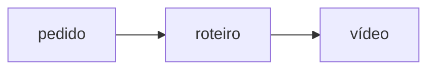

<p align="center">
  
</p>

<p align="center">
  
  
</p>

<!-- nota interna: não mergulhar em detalhe aqui — revisar depois -->

# Projeto de exemplo

Este repositório transforma um roteiro curto num vídeo com locução, e cada etapa grava um arquivo próprio.

## Começo

```bash
git clone https://github.com/exemplo/projeto.git
cd projeto
./setup.sh      # confere Node, FFmpeg e uv — e cria o .env.local
```

Rode o `setup.sh` uma vez. Ele cria `projects/`, `creatives/` e o `.env.local` sem apagar nada.

1. Instale o FFmpeg:
2. Instale o uv:
3. Abra o terminal na pasta:
4. Rode o agente.

> Dica: o preview ao vivo é opcional.

Os arquivos ficam em `projects/<slug>/` (`brief.md`, `plan.md`, `storyboard.json`, `brand.json`, `audio/words.json`) e o vídeo final sai em `creatives/reels/<slug>.mp4`.

| Arquivo | Para quem |
|---|---|
| `AGENTS.md` | a maioria dos agentes |
| `CLAUDE.md` · `GEMINI.md` | só importam o `AGENTS.md` |
| `01.png … NN.png` | slides |



<details>
<summary><b>Scripts</b> · o que roda por baixo</summary>

A documentação completa está em [docs/guia.md](https://github.com/exemplo/projeto/blob/main/docs/guia.md), com exemplos para cada etapa do fluxo.
O preço de referência do plano é R$ 1.000 por mês, e a versão 2.0.1 corrigiu o cálculo.
</details>

Licença MIT, motor sob Apache-2.0, em [`.agents/skills/LICENSE`](.agents/skills/LICENSE). Veja também <https://exemplo.dev/docs/v1.0>.
